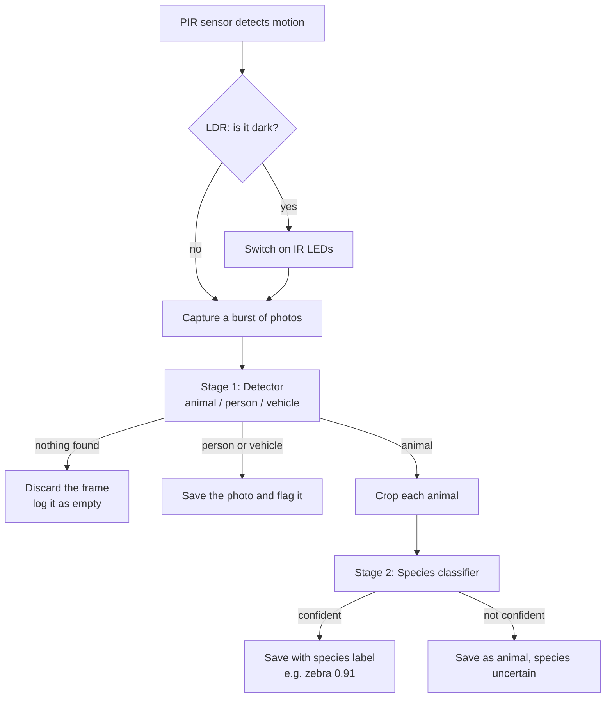

# Edge-AI Camera Trap with Edge Impulse & Arduino UNO Q

An on-device AI camera trap that discards empty shots and labels animals, people and
vehicles: MegaDetector brought to the edge.


Full write-up: [Hackster.io article](<HACKSTER LINK>)

---

## Contents

- [Why this exists](#why-this-exists)
- [How it works](#how-it-works)
- [What's in this repo](#whats-in-this-repo)
- [Part 1: Getting the training data (PC)](#part-1-getting-the-training-data-pc)
- [Part 2: Training the models (Edge Impulse)](#part-2-training-the-models-edge-impulse)
- [Part 3: The cascade app (Arduino UNO Q)](#part-3-the-cascade-app-arduino-uno-q)
- [Results](#results)
- [Credits](#credits)

---

## Why this exists

A normal camera trap takes a photo every time its motion sensor fires. Wind in the grass,
sun on a rock or a passing shadow is enough, so most photos end up empty, and someone has
to sort thousands of them by hand. The camera has no idea what it saw, so a poacher or a
stray herd is only discovered weeks later, when the memory card is collected.

This camera trap sorts its own photos on the spot. It throws away empty frames, labels the
rest as **animal**, **person** or **vehicle**, and names the **species** of each animal.
Everything runs on an Arduino UNO Q, with no internet connection.

## How it works

The camera checks every trigger in two stages, the same idea as
[MegaDetector](https://github.com/agentmorris/MegaDetector) but small enough to run on the
board:



| Part | Job | Where it runs |
|---|---|---|
| PIR sensor | Detects movement and wakes the camera | Microcontroller (STM32) |
| LDR | Measures light, so the board knows if it is night | Microcontroller |
| IR LEDs | Light the scene at night without a visible flash | Microcontroller |
| Detector | Finds animals, people and vehicles in the whole photo | Linux side (Qualcomm) |
| Species classifier | Names the species of each animal the detector found | Linux side |

The UNO Q has two processors, and the project uses both. The **microcontroller** watches the
sensors in real time and uses almost no power. The **Linux processor** only does work when
there is something to look at.


---

## What's in this repo

```
edge-ai-camera-trap/
├── camera-trap-app/      Arduino App Lab app: runs on the UNO Q
│   ├── app.yaml          App Lab app definition: web UI + two AI bricks and their models
│   ├── assets/           test web page (served on port 7000)
│   ├── python/main.py    the detector → classifier cascade (Linux side)
│   └── sketch/           sketch.ino + sketch.yaml: PIR, LDR and IR LEDs (microcontroller side)
├── training/             data scripts: run on a PC, NOT on the UNO Q
│   ├── lila_sample_puller.py   real camera trap data from LILA BC
│   ├── synth_paste.py          synthetic person/vehicle images
│   └── docs/notes_synthetic_data.md
├── case/                 3D-printed case files
└── images/               photos used in this README
```

**Just want to run the camera trap?** Skip to [Part 3](#part-3-the-cascade-app-arduino-uno-q).
You only need the `camera-trap-app` folder and two trained models.

**Want to train or improve the models?** Start at [Part 1](#part-1-getting-the-training-data-pc).

The repo itself is small, because no datasets are stored in it. The training scripts
download images only when you run them.

---

## Part 1: Getting the training data (PC)

Run these on a laptop or desktop with a few GB of free disk space. The UNO Q doesn't have
the storage for the datasets.

```bash
cd training
pip install -r requirements.txt     # pillow, numpy
```

### Where the data comes from

| Source | What it provides |
|---|---|
| [LILA BC](https://lila.science) **Snapshot Enonkishu** | ~29,000 camera trap images from the Maasai Mara, **Kenya**. Lots of empty frames and livestock |
| [LILA BC](https://lila.science) **Biome Health Project Maasai Mara** | ~37,000 images from 176 camera sites in **Kenya** |
| [LILA BC](https://lila.science) **Snapshot Serengeti** | Tanzania, same ecosystem and species as the Mara, with human-drawn boxes |
| **MegaDetector results** published by LILA | Animal boxes for every image, so nothing has to be drawn by hand |
| [COCO](https://cocodataset.org) | Cut-out people, vehicles and animals for the synthetic images |

### `lila_sample_puller.py`: real camera trap data

**What it does:** downloads the metadata for each dataset, matches every image with
MegaDetector's boxes, picks good examples, downloads them, and writes folders that upload
straight into Edge Impulse.

**How it picks examples:**

- **Labels must agree.** A frame is only used when the dataset's own label and
  MegaDetector agree. An "empty" frame must be marked empty by a person *and* have no
  MegaDetector detection above 0.1. An "animal" frame must have a confident animal box.
- **No real people or vehicles.** Frames with any person or vehicle detection are skipped.
  Those classes come from `synth_paste.py` instead (see below), so the model never sees an
  unlabelled person.
- **Day and night are balanced.** Night photos are black-and-white infrared shots, which
  the script detects automatically, and it aims for half of each.
- **Testing uses unseen cameras.** Each camera location goes entirely into training or
  entirely into testing, so test results show how the model does at sites it has never seen.
- **Detector frames** are resized to 640 px and get a `bounding_boxes.labels` file with the
  boxes.
- **Species crops** cut out the largest animal box with 25% padding for context. Animals cut
  off at the frame edge, tiny boxes (under 100 px) and frames with more than one species
  are skipped. Files are named `<species>.<id>.jpg`, so Edge Impulse can read the label from
  the name.
- **Safe on slow connections.** Failed downloads are retried, metadata is cached in
  `.lila_cache/`, and rerunning the same command resumes where it stopped.

**Commands:**

```bash
# Stage 1 detector data: 300 animal frames + 300 empty frames
python lila_sample_puller.py detector --per-class 300 --outdir ./ei_detector

# Stage 2 species data: 15 species + an "other_animal" class, 450 crops each
python lila_sample_puller.py species --per-species 450 --other \
  --merge "gazellegrants,gazellethomsons=gazelle" \
  --species gazelle,wildebeest,impala,zebra,livestock,warthog,hyena,lion,topi,dikdik,elephant,baboon,buffalo,giraffe,eland \
  --outdir ./ei_species

# Later: add more crops for the species the model confuses most.
# Same command + an override; only the NEW crops are copied to ./ei_species/new/
python lila_sample_puller.py species --per-species 450 --other \
  --merge "gazellegrants,gazellethomsons=gazelle" \
  --species gazelle,wildebeest,impala,zebra,livestock,warthog,hyena,lion,topi,dikdik,elephant,baboon,buffalo,giraffe,eland \
  --per-class-override "wildebeest=900,impala=900,gazelle=900,topi=800" \
  --outdir ./ei_species
```

**Useful options** (`python lila_sample_puller.py --help` lists them all):

| Option | Meaning |
|---|---|
| `--sources eno,mara,serengeti` | Which datasets to use (`eno,mara` = Kenya only) |
| `--merge "a,b=c"` | Merge look-alike species into one class |
| `--other` | Add an `other_animal` class drawn evenly from all remaining species |
| `--test-frac 0.2` | Share of camera locations held out for testing |
| `--workers 8` | Parallel downloads |

**Output:**

```
ei_detector/training/   *.jpg + bounding_boxes.labels
ei_detector/testing/    *.jpg + bounding_boxes.labels
ei_species/training/    zebra.mara_2018_MT40_021065.jpg, ...
ei_species/testing/
```

### `synth_paste.py`: synthetic person and vehicle frames

**Why it's needed:** LILA removes photos containing people for privacy reasons, and the
only public vehicle photos come from US farmland. There was almost nothing usable for a
Kenyan camera trap, so this script makes training images by pasting real people and
vehicles onto real, empty Kenyan camera trap photos. This copy-paste technique is well
established (*Cut, Paste and Learn*, 2017; *Simple Copy-Paste*, 2021; Beery et al., 2020 for
camera traps). See [training/docs/notes_synthetic_data.md](training/docs/notes_synthetic_data.md).

**What it does:**

1. **Backgrounds:** downloads empty frames from Snapshot Enonkishu and Biome Health Maasai
   Mara, half day and half night, only from *training* camera sites.
2. **Cut-outs:** reads the COCO annotations and cuts out people, motorbikes (with their
   riders), cars, trucks and East African-looking animals using their outline masks. It
   skips cut-off or overlapping objects, sports photos (skiers, tennis players) and
   black-and-white photos.
3. **Pasting:** places each object on the ground, smaller towards the horizon, and adds a
   soft shadow. It matches brightness and colour to the frame, turns objects grey in night
   frames, softens the edges, and adds blur, noise and JPEG compression so the pasted parts
   look like camera trap pixels.
4. **Balance:** motorbikes (boda bodas) make up about 45% of vehicles. Animals are pasted
   too, so the model can't learn the shortcut "pasted = person or vehicle".
5. **Output:** writes the images, a `bounding_boxes.labels` file, and a `preview/` folder
   with the boxes drawn on.

**Command:**

```bash
python synth_paste.py --per-class 300 --outdir ./ei_synth
```

The first run downloads the COCO annotations (~250 MB, cached). Look through
`ei_synth/preview/` and delete anything odd before uploading.

> **Rule:** synthetic images go into **Training only**, never Testing. Test results must
> come from real photos.

---

## Part 2: Training the models (Edge Impulse)

Two separate [Edge Impulse](https://studio.edgeimpulse.com) projects:

| | Detector | Species classifier |
|---|---|---|
| Project type | Object detection (bounding boxes) | Image classification |
| Upload | `ei_detector/training` → Training<br/>`ei_detector/testing` → Testing<br/>`ei_synth/training` → Training | `ei_species/training` → Training<br/>`ei_species/testing` → Testing<br/>Label: *Infer from filename* |
| Image input | 320×320, *Fit longest axis* | 160×160, *Fit longest axis* |
| Learning block | Object detection | Transfer learning, MobileNetV2 1.0 |
| Deploy for | Arduino UNO Q (Linux aarch64) | Arduino UNO Q (Linux aarch64) |

Choose **"Fit longest axis"** in both projects: the app on the board resizes images the
same way.


**Detector(Object Detection) Results**


**Species classifier**


---

## Part 3: The cascade app (Arduino UNO Q)

### How the app is built

The app follows App Lab's normal structure. The two AI models each run in their own
**brick**, a ready-made service App Lab starts in its own container:

| Brick | Model | Used by `main.py` as |
|---|---|---|
| `arduino:object_detection` | the detector (animal / person / vehicle) | `ObjectDetection().detect(image)` |
| `arduino:image_classification` | the species classifier | `ImageClassification().classify(image)` |

Which Edge Impulse model each brick loads is set in `app.yaml` (or in App Lab, in the brick's
**AI Models** tab). The camera is read with App Lab's `Camera` peripheral, and the sketch and
Python talk over the **Bridge**.

### What the two files do

**`sketch/sketch.ino`** runs on the microcontroller and handles everything time-critical:

- **Checks the PIR sensor every 20 ms.** On a new motion event (with a 5-second cooldown,
  so one animal doesn't trigger it a hundred times) it reads the LDR.
- **Decides day or night** with two thresholds (`DARK_BELOW` / `LIGHT_ABOVE`), so it
  doesn't flicker between modes at dusk.
- **Switches on the IR LEDs** if it's night, *before* telling the Linux side, so the scene
  is already lit when the photos are taken.
- **Sends a `motion` message** to the Linux side over the App Lab **Bridge**, saying whether
  it is night and the light level.
- **Switches the IR LEDs off** when the Linux side calls `ir_off`, or after 15 seconds as a
  safety cut-off.

**`python/main.py`** runs on the Linux side and does the AI work:

1. **Starting up.** It connects to the two bricks, asks each for its model's details (name,
   input size, how images were resized in training, labels) and prints them, so you can
   confirm the right models are loaded. Then it starts the camera.
2. **Waiting.** It waits for a `motion` message from the sketch. In `timer` mode it captures
   every few seconds instead, which is handy for testing without sensors.
3. **Capturing.** It throws away a few frames so the camera's exposure can adjust (for
   example to the IR LEDs), then captures a burst of 3 frames.
4. **Stage 1, detector.** It shrinks each frame to the detector's input size (e.g. 320×320)
   exactly as Edge Impulse did in training (the model reports its resize mode, e.g. "fit
   longest axis": scale, then pad with black) and sends it to the object detection brick.
   Boxes below `DETECTOR_THRESHOLD` (0.5) are dropped, and the rest are mapped back onto the
   full-resolution frame.
5. **Stage 2, classifier.** For every **animal** box it cuts that area out of the
   full-resolution frame with 25% padding (the same padding as the training crops) and sends
   it to the image classification brick. Below `CLASSIFIER_THRESHOLD` (0.6) the species is
   reported as `uncertain` instead of a guess.
6. **Saving.** Frames with detections are saved twice in `data/captures/<date>/` (`data` is
   App Lab's folder for an app's own files): a **clean copy** (to add to the training data
   later) and a **labelled copy** with boxes and names. Empty frames aren't saved, but each
   one gets a line in `data/captures/log.csv`, so you can see how many false triggers were
   filtered out.
7. **Tidying up.** It switches the IR LEDs off and ignores motion that happened while it was
   busy.

Only cropped animals go to the classifier. Empty frames cost one detector run, and people
and vehicles never reach the second model.

### Wiring

| Part | Connection |
|---|---|
| PIR sensor (e.g. HC-SR501) | VCC → 5V, GND → GND, OUT → **D2** |
| LDR + 10 kΩ resistor | LDR between 3.3V and **A0**; 10 kΩ from A0 to GND |
| IR LEDs (850 nm) | Logic-level N-channel MOSFET: gate → **D3** via 100 Ω, 10 kΩ gate → GND; LEDs (with resistors) from 5V to drain; source → GND |
| USB camera | Through a USB-C hub with power input |

The camera must be able to see infrared for night photos. Most webcams have an IR-cut
filter that blocks it, so use a NoIR camera or remove the filter.


### Install and run

1. **Copy the app onto the UNO Q** (over SSH):

   ```bash
   git clone --depth 1 https://github.com/<user>/edge-ai-camera-trap.git /tmp/edge-ai-camera-trap
   cp -r /tmp/edge-ai-camera-trap/camera-trap-app ~/ArduinoApps/camera-trap
   rm -rf /tmp/edge-ai-camera-trap
   ```

2. **Get the models.** In App Lab, link your Edge Impulse account (any brick's **AI Models**
   tab → **Train new AI model** → sign in) and download the detector and the species
   classifier to the board. To use the published models, first clone the public Edge
   Impulse projects ([detector](<DETECTOR PROJECT LINK>),
   [species classifier](<CLASSIFIER PROJECT LINK>)) into your own account.
3. **Pick the models.** Put the two model ids (their folder names in
   `~/.arduino-bricks/models/custom-ei/`) into `app.yaml`, which also sets each model's
   `.eim` path and shares the whole `custom-ei` folder with both bricks. That last part
   matters: App Lab shares only one model folder per app, so with two custom models one
   brick would otherwise not find its model.
   Details: [camera-trap-app/README.md](camera-trap-app/README.md#3-pick-the-models-in-the-app).
4. **Run.** Click **Run**. The Python output (`docker logs <app>-main-1` over SSH) should show:

   ```
   Starting models ...
     ObjectDetection: <detector project> (project 1119962), type=object_detection, input=320x320, ...
     ImageClassification: <species project> (project 1121401), type=classification, input=160x160, ...
   Camera trap ready (pir mode). Saving to /app/data/captures
   [14:02:11] pir trigger (night=False, light=612)
     frame 0: animal/zebra 0.87 (1.2s)
   ```

5. **Open the test page** at `http://<board-name>.local:7000`: live camera, a **Capture now**
   button, trigger-mode switch, threshold sliders, live sensor readings, IR LED test and every
   result with its labelled frames. See
   [camera-trap-app/README.md](camera-trap-app/README.md#5-test-it-from-the-web-page).
6. **Test step by step:**
   - Start with `TRIGGER_MODE = "timer"` and no sensors attached. Point the camera at a
     printed or on-screen animal photo.
   - Wire the sensors, switch back to `"pir"`, and walk in front of the camera.
   - Cover the LDR to simulate night and check that the IR LEDs turn on during capture.
   - Use the light values in the log to tune `DARK_BELOW` / `LIGHT_ABOVE` in the sketch.

Settings and troubleshooting: [camera-trap-app/README.md](camera-trap-app/README.md).


---

## Results

| Model | Result |
|---|---|
| Detector (animal / person / vehicle) | mAP@50 0.72 (validation) |
| Species classifier (15 species + other) | 78.9% accuracy (validation) |

The species classifier improved through better data, not a bigger model:

| Version | Change | Accuracy |
|---|---|---|
| v1 | 15 species, ~150 tight crops each | 60.1% |
| v2 | Padded crops, cut-off and tiny animals removed, 450 per species, gazelles merged, `other_animal` class | 74.7% |
| v3 | Extra crops for the most-confused species | 78.9% |

---

## Credits

- [LILA BC](https://lila.science): hosting the camera trap datasets
- Snapshot Enonkishu (Snapshot Safari), Biome Health Project Maasai Mara (WWF-UK / UCL), Snapshot Serengeti: the images
- [MegaDetector](https://github.com/agentmorris/MegaDetector): the boxes used as training labels
- [COCO](https://cocodataset.org) (Lin et al., 2014): cut-outs for synthetic images (annotations CC BY 4.0; images under their own Creative Commons licences)
- Dwibedi et al., 2017, *Cut, Paste and Learn*; Ghiasi et al., 2021, *Simple Copy-Paste*; Beery et al., 2020, *Synthetic Examples Improve Generalization for Rare Classes*
- [Edge Impulse](https://edgeimpulse.com) and [Arduino](https://www.arduino.cc)